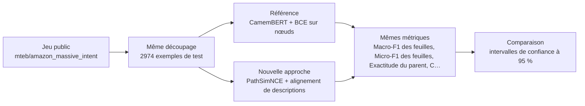
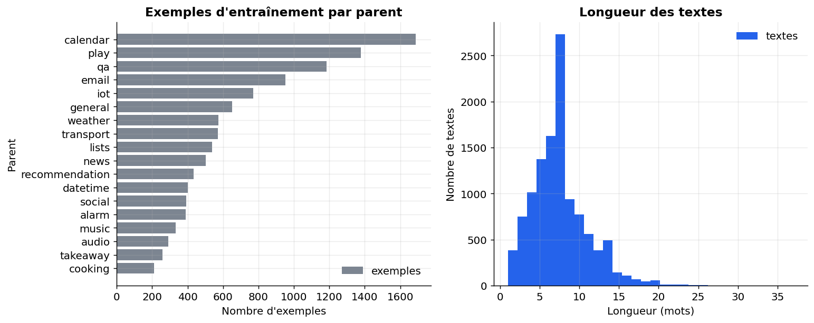
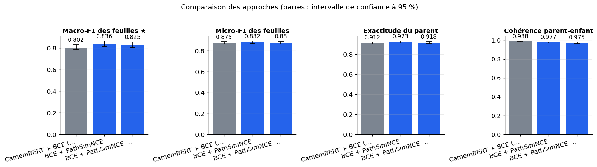
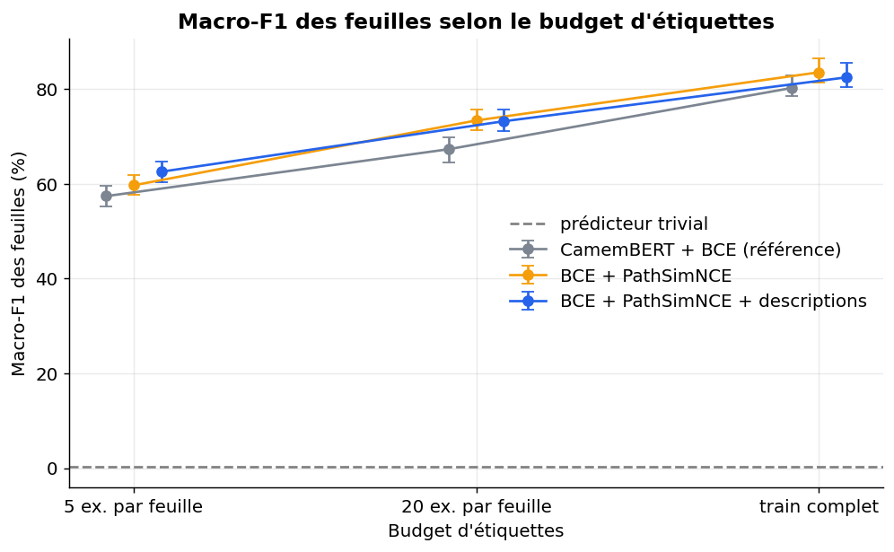
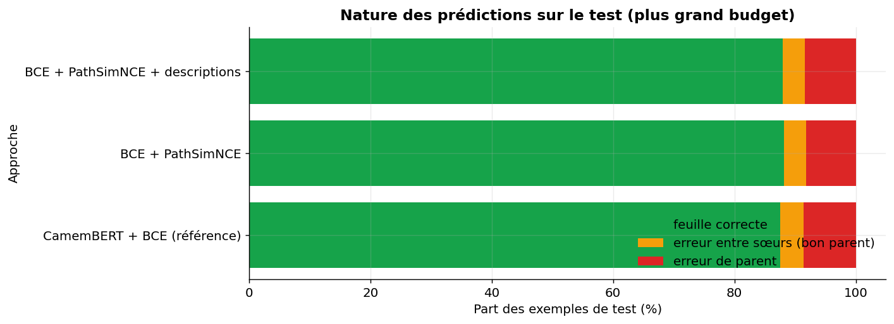
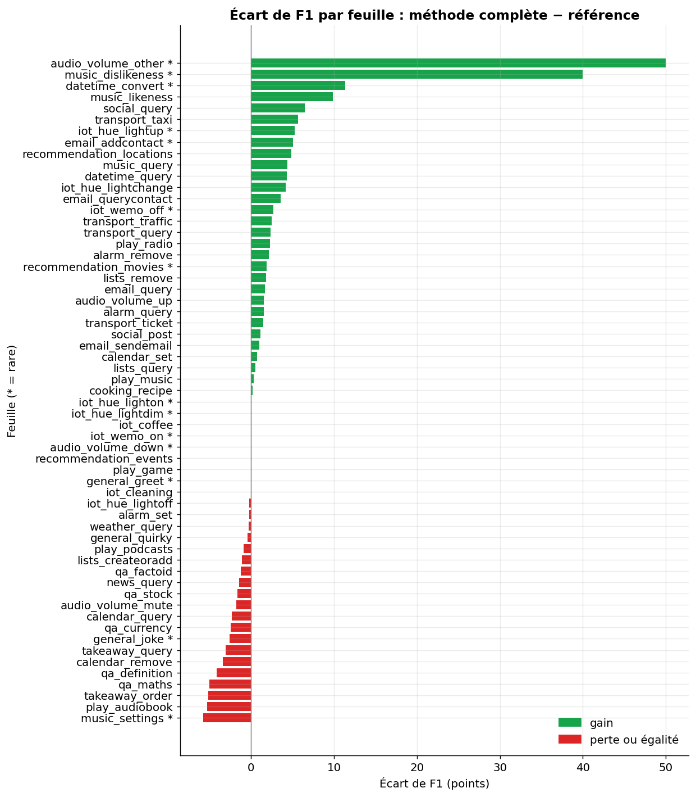

# Des pertes d'alignement par chemins racine-feuille améliorent-elles un CamemBERT sur une classification hiérarchique en français, à budget d'étiquettes variable ?

> **En bref.** Les pertes par chemins améliorent nettement le macro-F1 en français, mais dégradent la cohérence parent-enfant, donc l'hypothèse complète n'est pas confirmée. Les descriptions par gabarit n'apportent rien de plus, et une seule exécution par configuration limite la portée. Macro-F1 des feuilles : 0,825 [0,804 ; 0,856] pour BCE + PathSimNCE + descriptions, contre 0,802 [0,786 ; 0,83] pour CamemBERT + BCE (référence) (2974 exemples de test, échelle complète).

## Sommaire

1. [La question](#la-question)
2. [Le protocole](#le-protocole)
3. [Les résultats](#les-résultats)
4. [Ce qu'il faut retenir](#ce-quil-faut-retenir)
5. [Rejouer l'expérience](#rejouer-lexpérience)
6. [Contenu du dépôt](#contenu-du-dépôt)
7. [Références](#références)
8. [Glossaire](#glossaire)

## La question

Quand on range des messages par motif puis par sous-motif, un classifieur ordinaire ne sait pas que deux sous-motifs d'un même motif se ressemblent. L'expérience teste deux pertes d'entraînement venues d'une publication récente. La première apprend au modèle le « plan de l'arbre » des catégories. La seconde rapproche chaque texte d'une phrase qui décrit sa catégorie. Le modèle est le même dans tous les cas (CamemBERT) et il coûte autant à l'usage. On compare ces pertes à un entraînement classique sur un jeu français à 18 domaines et 60 intentions, avec 5 exemples, 20 exemples ou toutes les annotations par classe. Le notebook conclut de lui-même si le gain atteint +1 point de macro-F1 et +2 points de cohérence, ou si l'écart reste dans le bruit.

**Hypothèse testée.** L'ajout de PathSimNCE (puis de l'alignement de descriptions) à une perte BCE sur nœuds augmente le macro-F1 des feuilles d'au moins 1 point et la cohérence parent-enfant d'au moins 2 points, surtout à 5 exemples par classe.

| | Référence | Nouvelle approche |
|---|---|---|
| **Approche** | CamemBERT + BCE sur nœuds | PathSimNCE + alignement de descriptions |
| **Principe** | CamemBERT-base avec tête multi-étiquettes (scénario et intention) entraînée en entropie croisée binaire ; prédiction de la feuille de plus forte probabilité. | Perte contrastive texte↔chemins avec cibles pondérées par la proximité dans l'arbre, plus alignement texte↔descriptions de chemins, utilisés seulement à l'entraînement. |
| **Mise en œuvre** | transformers AutoModel + tête linéaire sur 78 nœuds (18 parents + 60 feuilles), BCE, 5 époques, lr 5e-5, batch 32, fp16. | Réimplémentation : un vecteur appris par chemin, InfoNCE avec poids de similarité selon l'ancêtre commun, négatifs durs parmi chemins voisins mal classés ; descriptions de chemins générées par gabarit à partir des libellés (pas de LLM propriétaire) et encodées par l'encodeur partagé, perte contrastive ; poids des pertes 0,5 ; inférence = tête BCE seule. En phase privée, les descriptions sont générées par le LLMaaS. |
| **Modèles** | [`almanach/camembert-base`](https://huggingface.co/almanach/camembert-base) | [`almanach/camembert-base`](https://huggingface.co/almanach/camembert-base) |

## Le protocole



- **Données** : [`mteb/amazon_massive_intent`](https://huggingface.co/datasets/mteb/amazon_massive_intent) (configuration `fr`), évaluation sur le découpage `test` (2974 exemples). Seul jeu français chargeable avec arbre à parent unique (18 scénarios → 60 intentions) et classes proches au sein d'un scénario.
- **Écarts avec des données réelles** : Énoncés d'assistant vocal courts, hors services financiers, 60 classes et 2 niveaux, mono-étiquette, descriptions par gabarit et non générées par LLM.
- **Déroulé** : Jeu public : MASSIVE en français (mteb/amazon_massive_intent, config fr). Le scénario (préfixe de l'intention) sert de parent, ce qui donne 18 parents et 60 feuilles. On garde les splits officiels : train pour apprendre, validation pour choisir l'époque, test pour mesurer. Trois variantes sont comparées : CamemBERT-base + BCE sur les nœuds, + PathSimNCE, + PathSimNCE et alignement de descriptions par gabarit (poids 0,5 chacun). Elles partagent le même encodeur, la même tête, les mêmes réglages (AdamW, lr 5e-5 pour l'encodeur et 1e-3 pour les couches neuves, lots de 32, fp16 sur GPU) et la même règle d'époque (meilleur macro-F1 de validation). L'entraînement est refait à trois budgets : 5 et 20 exemples par feuille, puis le train complet, tirés avec la même graine pour toutes les variantes. Cinq métriques sont mesurées sur les mêmes exemples de test : macro-F1 et micro-F1 des feuilles, exactitude du parent, cohérence parent-enfant et macro-F1 des feuilles rares, avec intervalles bootstrap à 95 %, écarts appariés et comparaison à un prédicteur trivial.
- **Deux échelles, un seul code** : l'échelle réduite (300 exemples, CPU, 3 min) valide la mécanique ; l'échelle complète (GPU T4 (Google Colab), 19 min) donne les résultats.



*À gauche, nombre d'énoncés d'entraînement par scénario (parent) : la répartition est inégale. À droite, longueur des énoncés en mots : textes très courts.*

**Les métriques**

| Métrique | Ce qu'elle mesure | Meilleur si |
|---|---|---|
| Macro-F1 des feuilles ★ | Moyenne du F1 de chaque classe fine (sous-motif), où chaque classe pèse autant, même rare ; c'est la métrique principale. | plus haut |
| Micro-F1 des feuilles | F1 calculé sur l'ensemble des prédictions de classe fine ; avec une seule étiquette par texte, il égale la part de textes bien classés. | plus haut |
| Exactitude du parent | Part des textes dont le motif (parent) prédit par la tête est le bon. | plus haut |
| Cohérence parent-enfant | Part des prédictions où le parent prédit est bien le parent de la feuille prédite. | plus haut |
| Macro-F1 des feuilles rares | Macro-F1 calculé seulement sur le quart des classes les moins fréquentes à l'entraînement. | plus haut |

★ métrique principale : c'est elle qui tranche la question.

## Les résultats

| Approche | Macro-F1 des feuilles ★ ↑ | Micro-F1 des feuilles ↑ | Exactitude du parent ↑ | Cohérence parent-enfant ↑ | Macro-F1 des feuilles rares ↑ | Latence médiane (ms) ↓ |
|---|---|---|---|---|---|---|
| CamemBERT + BCE (référence) (référence) | 0,802 [0,786 ; 0,83] | 0,875 [0,863 ; 0,888] | 0,912 [0,901 ; 0,922] | **0,988 [0,984 ; 0,991]** | 0,556 [0,512 ; 0,641] | 13,2 |
| BCE + PathSimNCE (nouvelle approche) | **0,836 [0,814 ; 0,864]** | **0,882 [0,87 ; 0,894]** | **0,923 [0,913 ; 0,932]** | 0,977 [0,971 ; 0,982] | **0,668 [0,601 ; 0,768]** | 12,9 |
| BCE + PathSimNCE + descriptions (nouvelle approche) | 0,825 [0,804 ; 0,856] | 0,88 [0,868 ; 0,892] | 0,918 [0,907 ; 0,928] | 0,975 [0,968 ; 0,98] | 0,633 [0,561 ; 0,738] | 13,1 |

★ métrique principale · ↑ plus haut = meilleur · ↓ plus bas = meilleur · entre crochets : intervalle de confiance à 95 % (bootstrap) · en gras : la meilleure valeur.



*Une barre par approche et par métrique, au plus grand budget ; les traits donnent l'intervalle de confiance à 95 % (bootstrap du test). Plus haut = mieux.*



*Macro-F1 des feuilles (en %) de chaque variante selon le nombre d'exemples d'entraînement par feuille ; traits = intervalle à 95 % ; pointillés = prédicteur trivial. Plus haut = mieux.*



*Pour chaque approche, part des exemples de test bien classés, des erreurs entre feuilles sœurs (bon parent) et des erreurs de parent. Une méthode fondée sur l'arbre devrait réduire surtout la part du milieu.*



*Écart de F1 (en points) entre BCE + PathSimNCE + descriptions et la référence, feuille par feuille, au plus grand budget ; vert = gain, rouge = perte ou égalité ; * = feuille rare.*

**Lecture** (confiance moyenne). À l'échelle complète (tout le jeu de test, 2 974 exemples, GPU T4), PathSimNCE améliore le macro-F1 des feuilles de la référence de +2,3 pts (5 exemples par feuille), +6,1 pts (20) et +3,3 pts (train complet), avec des intervalles appariés au-dessus de zéro. Les descriptions par gabarit n'ajoutent rien (+5,1, +5,9 et +2,2 pts). En revanche, la cohérence parent-enfant baisse partout (de -1,0 à -4,8 pts), donc l'hypothèse complète n'est pas soutenue, et le gain en exactitude globale reste faible (+0,7 pt au train complet). Une seule exécution par configuration et un jeu d'assistant vocal en français rendent l'ampleur des gains incertaine. Les chiffres ne se comparent pas à ceux de la source (autres jeux, autre tâche), et l'échelle réduite, sous le niveau du hasard, n'apporte aucune information.

## Ce qu'il faut retenir

**Réserves**

- Le gain de macro-F1 est réel sur ce jeu, mais il s'accompagne d'une baisse de la cohérence parent-enfant. L'hypothèse complète n'est donc pas confirmée, et un contrôle au routage devient plus nécessaire.
- Le sens du gain de PathSimNCE sur la référence est plausible, mais son ampleur (de +2 à +6 pts) reste incertaine. Rien ne permet de classer PathSimNCE seul et PathSimNCE avec descriptions.
- Sur l'ensemble des énoncés, l'amélioration est faible (moins d'un point d'exactitude). Le gain de macro-F1 est surtout porté par un petit nombre de classes, souvent rares, avec peu d'exemples de test.

**Limites**

- Une seule exécution par configuration : des écarts de moins de 1 point peuvent venir de la graine et non de la méthode.
- Le jeu public contient des énoncés d'assistant vocal courts, hors services financiers. L'arbre n'a que deux niveaux et une étiquette par texte, alors que la source utilise des hiérarchies plus profondes.
- En phase publique, les descriptions viennent d'un gabarit et non d'un LLM, ce qui défavorise la méthode d'après la source. En phase privée, on produit une description par chemin et non par couple texte-chemin.
- Certains détails de PathSimNCE (forme de la similarité, poids 0,2 des voisins, ×2 pour les négatifs durs) sont des choix de réimplémentation, non vérifiés contre le code d'origine.
- Aucune variante ne garantit la cohérence parent-enfant : en usage réel, une contrainte au moment du routage reste nécessaire.

**Pistes d'amélioration**

- La cohérence parent-enfant de la référence est déjà proche de 100 % au train complet. Une baisse y est donc mesurable, mais une hausse était impossible.
- Les scores aux petits budgets sont un peu optimistes pour toutes les variantes, car le choix de l'époque s'appuie sur beaucoup plus d'étiquettes que le budget annoncé. L'écart sur la référence pourrait se réduire avec un entraînement plus long.
- Cette expérience ne permet pas de juger l'apport des descriptions générées par un LLM. Elle teste seulement une version simplifiée, qui n'ajoute rien à PathSimNCE seul.

## Rejouer l'expérience


### Sur le jeu public

```bash
pip install -r requirements.txt
jupyter lab experiment.ipynb
```

Dans la cellule de paramètres : `PHASE = "public"`, puis `SCALE = "reduced"` (quelques minutes sur CPU, pour vérifier) ou `SCALE = "full"` (résultats publiés ; GPU T4 (Google Colab), 19 min). Les résultats sont écrits dans `outputs/results_public.json`, les figures dans `outputs/figures/` (les résultats publiés en sont une copie, dans `results/` et `figures/`).

### Sur vos données (environnement de services financiers)

Le même protocole, sur vos données, dans votre environnement : seule la cellule `PRIVATE_CONFIG` s'adapte. Le code de cette phase a été exécuté de bout en bout sur un jeu factice écrit comme un vrai export (dossier de fichiers, CSV « ; » en Windows-1252, colonnes à faire correspondre), contre un service simulé à la convention OpenAI (clé lue dans un fichier de secret), modèles chargés hors ligne.

**1. Préparer le jeu de données.** Colonnes attendues (les noms peuvent différer : on les fait correspondre dans `PRIVATE_CONFIG["columns"]`) :

| Colonne attendue | Type | Contenu |
|---|---|---|
| `text` | string | Texte du message ou e-mail anonymisé |
| `reason` | string | Motif (niveau 1) |
| `sub_reason` | string | Sous-motif (niveau 2) |
| `sub_reason_description` | string | Description courte du sous-motif pour l'alignement |
| `received_at` | datetime | Date de réception |

Volume conseillé : ≥ 30 000 textes, ≥ 20 par sous-motif pour l'entraînement complet, taxonomie à parent unique

**Conditions pour que la comparaison soit concluante**

- Taxonomie à parent unique, figée sur la période
- Au moins 20 textes par sous-motif en entraînement et 10 en test
- Annotations contrôlées par double lecture sur 5 % des textes
- Découpage temporel entre entraînement et test
- Anonymisation des données personnelles
- Conserver les classes rares pour mesurer leur F1 à part

**Constituer l'extraction.** Extraire les textes avec motif et sous-motif validés, vérifier l'unicité du parent, rédiger ou générer les descriptions de sous-motifs, découper par date, sous-échantillonner pour simuler les budgets.

**2. Rendre les modèles disponibles hors ligne** (si l'environnement n'a pas accès à Internet) :

```bash
python download_models.py ./models --scale full   # sur un poste connecté
```

puis copier le dossier dans l'environnement et le désigner par `LOCAL_MODELS_DIR`. Les révisions téléchargées sont celles des résultats publiés.

**3. Configurer** l'environnement du notebook à partir de `private.env.example` (ou directement la cellule `PRIVATE_CONFIG`). Jamais de clé dans le notebook : une variable, un fichier de secret monté ou la saisie masquée.

| Variable | Rôle |
|---|---|
| `PRIVATE_DATA` | jeu de données : fichier ou dossier (csv, tsv, parquet, jsonl, json, xlsx) ; `fake` pour tester le code sur un jeu factice |
| `LOCAL_MODELS_DIR` | (facultatif) dossier des poids copiés localement (`org--nom/`), pour travailler sans Internet |
| `LLMAAS_BASE_URL, LLMAAS_MODEL` | service LLM interne à la convention OpenAI (URL en `/v1`, nom du modèle) |
| `LLMAAS_API_KEY ou LLMAAS_API_KEY_FILE` | clé du service, par variable ou par fichier de secret monté |
| `<SERVICE>_HEADERS` | (facultatif) en-têtes HTTP exigés par la passerelle, objet JSON |
| `HTTPS_PROXY, SSL_CERT_FILE, PIP_INDEX_URL` | (facultatif) proxy, autorité de certification et miroir PyPI d'entreprise |
| `SERVICE_TIMEOUT_S, SERVICE_MAX_RETRIES` | (facultatif) délai (120 s) et tentatives (3) par appel de service |

**4. Lancer** avec `PHASE = "private"` (et `SCALE = "full"`). La cellule d'initialisation affiche une liste de contrôle (jeu, colonnes, modèles, services) et s'arrête sur ce qui manque, avant tout calcul. Les résultats sont écrits dans `outputs/results_private.json` (avec versions, machine, graine et empreinte des données).

**5. Interpréter.** Métriques métier à suivre : Macro-F1 par motif, taux d'incohérence motif/sous-motif, taux de routage correct.

**Garde-fous.** Descriptions générées par le service interne, jamais par une API externe ; vérifier la cohérence avant routage. En phase `private`, le notebook refuse les services publics (OpenAI, Anthropic, Mistral, Hugging Face…) et le HTTP non chiffré, n'affiche aucune donnée brute et coupe la télémétrie des bibliothèques ; avec `LOCAL_MODELS_DIR`, il travaille sans accès à Internet.

## Contenu du dépôt

| Fichier | Contenu |
|---|---|
| `experiment.ipynb` | le notebook : question, données, deux approches, évaluation, analyse, bilan (sorties incluses) |
| `helpers.py` | fonctions communes : phases et échelles, services internes, lecture des données, mesures, figures |
| `results/results.json` | résultats publiés (échelle complète) : métriques, intervalles, latences, versions et machine |
| `results/results_reduced_scale.json` | résultats de l'échelle réduite (validation de la mécanique, CPU) |
| `figures/` | figures du notebook reprises dans ce README |
| `requirements.txt` | versions exactes des bibliothèques utilisées |
| `private.env.example` | variables d'environnement pour exécuter le notebook sur vos données |
| `download_models.py` | téléchargement des poids des modèles, pour un environnement sans Internet |

## Références

**Sources de l'approche**

- [Path-Level Structural and Semantic Alignment for Hierarchical Multi-Label Text Classification](https://arxiv.org/abs/2611.12420)

**Autres jeux de données examinés**

| Jeu | Accès | Intérêt | Pourquoi pas ici |
|---|---|---|---|
| [DeepPavlov/banking77_fr](https://huggingface.co/datasets/DeepPavlov/banking77_fr) | Hugging Face, libre | 77 classes proches de services financiers, sans arbre. | Parents à inventer, cohérence artificielle. |
| [mteb/MTOPIntentClassification](https://huggingface.co/datasets/mteb/MTOPIntentClassification) | Hugging Face, libre | ~113 intentions déséquilibrées, domaines dans un autre jeu. | Appariement ligne à ligne non vérifié, licence inconnue. |
| [marcelsun/wos_hierarchical_multi_label_text_classification](https://huggingface.co/datasets/marcelsun/wos_hierarchical_multi_label_text_classification) | Hugging Face, libre | WOS anglais, réplication de l'article. | Anglais, hiérarchie à reconstruire. |
| [DeepPavlov/clinc150_fr](https://huggingface.co/datasets/DeepPavlov/clinc150_fr) | Hugging Face, libre | 150 intentions françaises. | Domaines absents des colonnes. |
| [BlurbGenreCollection-HMC](https://github.com/uhh-lt/BlurbGenreCollection-HMC) | téléchargement libre | Hiérarchie profonde, anglais. | Hors Hub, anglais. |
| [Corpus d'e-mails TALN 2026](https://talnarchives.atala.org/TALN/TALN-2026/68.pdf) | accès restreint | E-mails français, 21 catégories. | Non commercial, sans hiérarchie. |

**Licences**

- Jeu de données `mteb/amazon_massive_intent` : apache-2.0
- `almanach/camembert-base` : mit
- Vérifier la licence de chaque modèle avant tout usage au-delà de l'évaluation.

## Glossaire

| Terme | Définition |
|---|---|
| **BCE (entropie croisée binaire)** | Perte qui traite chaque étiquette comme une question oui/non indépendante et pénalise les réponses fausses. |
| **PathSimNCE** | Perte qui rapproche le texte du vecteur de son chemin dans l'arbre, un peu de ses chemins frères, et le repousse des chemins confondus. |
| **InfoNCE** | Perte contrastive : le modèle doit retrouver la bonne cible parmi plusieurs candidats, grâce à une softmax sur des similarités. |
| **Négatif dur** | Mauvaise réponse que le modèle confond actuellement avec la bonne ; on la repousse plus fort. |
| **Budget d'étiquettes** | Nombre d'exemples annotés disponibles par classe pour l'entraînement. |
| **Macro-F1** | Moyenne du score F1 (compromis précision/rappel) calculé classe par classe, chaque classe comptant autant. |
| **Bootstrap apparié** | Tirage répété des mêmes exemples de test pour deux modèles afin d'estimer si leur écart dépasse le hasard de l'échantillon. |
| **Prédicteur trivial** | Règle naïve qui répond toujours la classe la plus fréquente ; tout modèle utile doit faire mieux. |
| **Token** | Morceau de mot que le modèle lit ; la longueur des entrées se mesure en tokens. |
